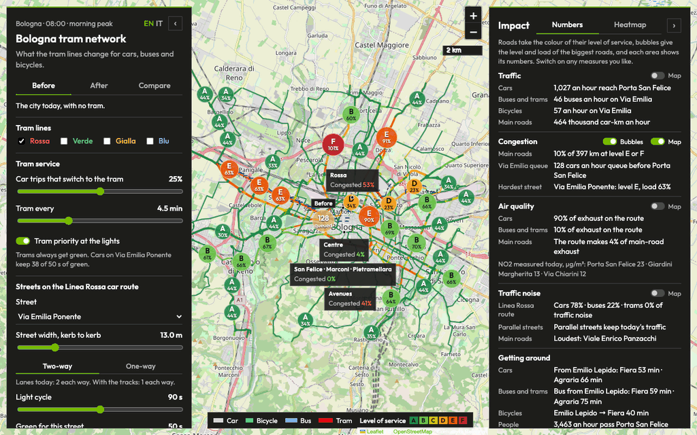
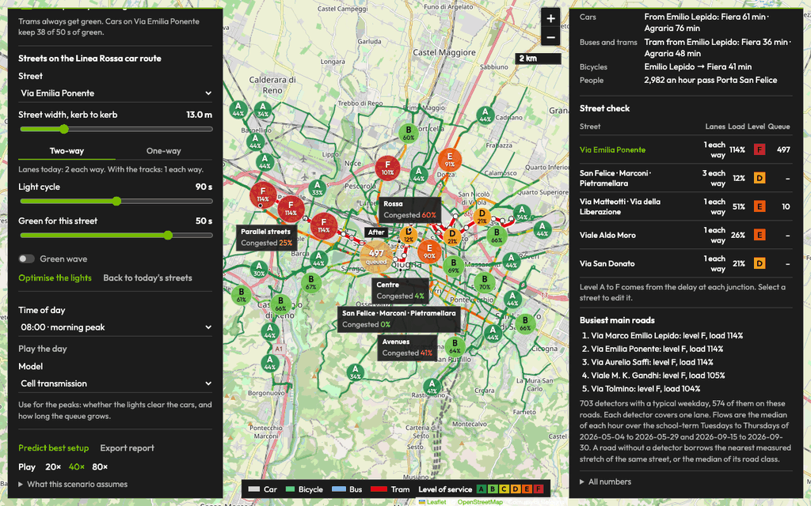
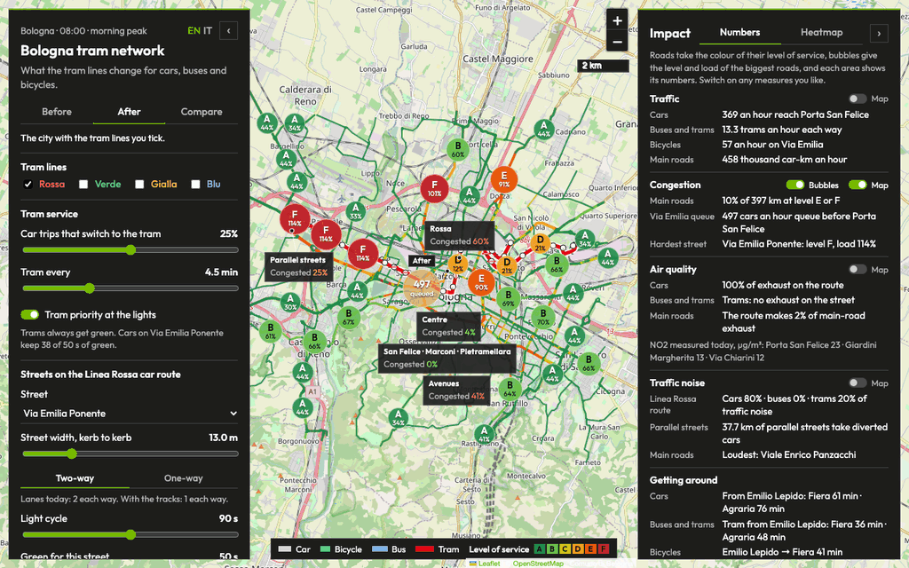
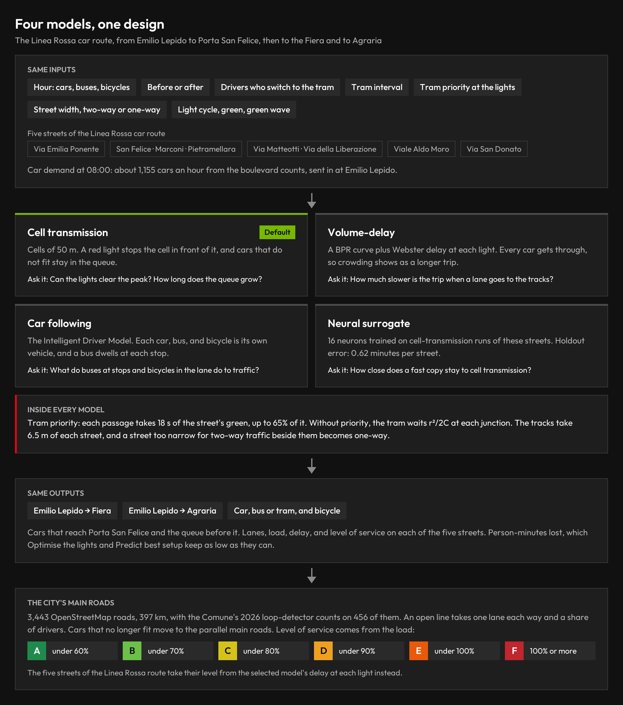

# Bologna tram traffic

A model of the tram lines planned for Bologna. **Rossa** runs from Borgo Panigale through the historic centre to the Fiera (Michelino) and to Agraria at Pilastro. **Verde**, **Gialla**, and **Blu** switch on beside it.

The page shows what the tram lines change for cars, buses, and bicycles: traffic, congestion, air quality, and noise, on the Linea Rossa route and on every main road of the city. Every option stays available at all times. The left panel holds the design. The right panel holds the results.

The [user guide](docs/GUIDE.md) walks through every control, the map, and the numbers, with recipes for deciding on tram priority, light plans, and one-way streets.



## Using the map

**Before** is the city today, with no tram. **After** draws the lines you tick. **Compare** shows the change: green is better, red is worse. Moving a lever that only exists with the tram, such as the tram interval, takes the map to After so the change is visible.

Either panel hides with its **‹** or **›** button to give the map the whole window, and a tab at the top corner brings it back. The keys **[** and **]** hide or show one panel and **\\** both. **1**, **2**, and **3** pick Before, After, and Compare, and **Space** pauses the vehicles. EN and IT switch the language.

### Design panel (left)

- **Tram lines.** Rossa, Verde, Gialla, and Blu. An open line takes a share of drivers, gives the tracks a lane each way on its streets, and sends the cars that no longer fit onto parallel main roads.
- **Tram service.** The share of car trips that switch to the tram, the interval between trams, and **Tram priority at the lights**. With priority, every tram passage takes 18 seconds of the street's green. Without it, the tram waits at red like the cars, about r²/2C seconds a junction, and the note under the switch gives the extra minutes from Emilio Lepido to the Fiera.
- **Streets on the Linea Rossa car route.** Pick one of five streets: Via Emilia Ponente; San Felice · Marconi · Pietramellara (the car route around the historic centre); Via Matteotti · Via della Liberazione; Viale Aldo Moro; Via San Donato. For each one, set:
  - **Street width**, kerb to kerb. It sets the lanes before and after.
  - **Two-way or one-way.** A street too narrow for two-way traffic next to the tracks becomes one-way on its own, and the note says so.
  - **Light cycle**, **green for this street**, and **green wave**. The cross street always keeps at least 30 seconds.
  - **Optimise the lights** finds the cycle, green, and wave for each street that lose the fewest person-minutes with the selected model.
  - **Back to today's streets** restores the widths, directions, and lights of today.
- **Time of day** and **Play the day**, from 06:00 to 21:00.
- **Model**: cell transmission, volume-delay, car following, or the neural surrogate, each with a line on when to use it.
- **Predict best setup** searches tram intervals, priority, and one-way streets, then optimises the winner's lights and applies the result to the map. **Export report** downloads an HTML report of the current design, its impact, and the setups compared.



### Impact panel (right)

**Numbers | Heatmap** chooses the map view.

- **Numbers** colours every main road by its level of service, A to F, and labels each area (the centre, the avenues, San Felice · Marconi · Pietramellara, each open line, and the parallel streets that take diverted cars) with its numbers. Turn on as many measures as you like with the **Map** switch on each card. Congestion also draws the queue on Via Emilia before Porta San Felice and, with its **Bubbles** switch, a bubble with the level and load of each stretch of about 2 km of the biggest roads: in Compare, the change. The bubbles never overlap, the streets the tram runs along come first, and zooming in shows more. Air quality also draws the NO2 measured at the three stations.
- **Heatmap** makes one measure glow along the main roads, on a dark basemap, scaled to that measure's spread across the city today. The **Map** switches then pick the measure.



The cards give each mode its own row:

| Card | Rows |
| --- | --- |
| Traffic | Cars that reach Porta San Felice · buses, or trams, an hour · bicycles on Via Emilia · car-km on the main roads |
| Congestion | Share of the main roads at level E or F · the Via Emilia queue, and the cars sent round one-way streets · the hardest street on the route |
| Air quality | Exhaust from cars · from buses (trams have none on the street) · on the main roads, and the NO2 measured today |
| Traffic noise | Cars, buses, and trams on the route · parallel streets · main roads |
| Getting around | Car, bus or tram, and bicycle from Emilio Lepido to the Fiera and from Emilio Lepido to Agraria · people an hour past Porta San Felice |

**Street check** lists the five streets of the car route: lanes, load, level of service, and queue. Select a row to edit that street. **Busiest main roads**, or in Compare **Main roads that change most**, names the roads across the city where the level changes most. Hovering a road on the map gives its lanes, cars an hour, load, level, and whether a loop detector counts it. Hovering a bubble gives the level, load, and cars an hour of its stretch, and its busiest point.

## What the model does

### The Linea Rossa route

Eastbound traffic on the Linea Rossa car route, from Emilio Lepido to Porta San Felice, then around the historic centre on San Felice · Marconi · Pietramellara and out along Via Matteotti to the Fiera (56% of cars) or Via San Donato to Agraria (44%).

- **Lanes.** Before, a street of width W has ⌊W / 6.5⌋ lanes each way. With the tram, the tracks take 6.5 m. Two-way leaves ⌊(W − 6.5) / 6.5⌋ lanes each way, one-way leaves ⌊(W − 6.5) / 3.25⌋. The streets start at 13 m; San Felice · Marconi · Pietramellara, which has no tracks, starts at 20 m.
- **Lights.** Today's lights are modelled as a 90 second cycle with 50 seconds of green, which lets these streets carry the counted cars. Lights closer than 60 m count as one junction. A lane passes 1,800 cars an hour of green. A green wave lines the lights up at 30 km/h: it removes 30% of the signal delay in volume-delay, sets the signal offsets in cell transmission and car following, and is one of the surrogate's inputs.
- **Priority.** With priority, each tram passage, in both directions, takes 18 seconds of the green, up to 65% of it. Without priority, the tram waits r²/2C at each junction.
- **One-way.** Cars of the other direction, 75% of the main flow, go round on parallel main roads.

Same morning, Rossa on, a quarter of drivers switching, a tram every 4.5 minutes with priority, today's lights:

| Model | Cars an hour that reach Porta San Felice | Queue before Porta San Felice | Car, Emilio Lepido to the Fiera | Transit, Emilio Lepido to the Fiera |
| --- | --- | --- | --- | --- |
| Cell transmission | 1,027 → 369 | 128 → 497 | 53 → 61 min | 59 → 36 min |
| Volume-delay | 1,155 → 866 | 0 → 106 over capacity | 35 → 50 min | 48 → 36 min |
| Car following | 1,155 → 569 | 0 → 297 | 33 → 54 min | 43 → 36 min |
| Neural surrogate | 984 → 364 | 171 → 503 | 50 → 50 min | 57 → 36 min |

### Lights and the best setup

**Optimise the lights** tries a 60, 90, or 120 second cycle, 45%, 60%, or 75% of it as green, and the green wave on or off, one street at a time, and keeps each change that lowers the person-minutes lost in an hour. Those minutes count the delay of every car that wants the trip, the delay on the streets that cross the route (300 cars an hour at each junction, 4 seconds lost at each change of phase), 30 minutes for each car that cannot get through, and the riders' time on board.

With cell transmission at 08:00, the optimiser gives Via Emilia Ponente, San Felice · Marconi · Pietramellara, and Via Matteotti · Via della Liberazione a 120/90 second cycle, and Viale Aldo Moro and Via San Donato 90/60 seconds, all five with a green wave. Cars that reach Porta San Felice go from 369 to 764 an hour, the queue from 497 to 102, and the car trip from Emilio Lepido to the Fiera from 61 to 46 minutes. Before keeps today's lights, so part of that gain would also be available without the tram.

**Predict best setup** tries a tram every 3 to 8 minutes, with and without priority, with the streets as set or one-way where the tracks run, then optimises the winner's lights. Its cost, in person-minutes an hour, adds 30 minutes for each rider left at the stop, 10 for each car sent round a one-way street, and 300 for each tram an hour it takes to run the service. At 08:00, all four models choose a tram every 5 minutes, without priority, with optimised lights: the longest interval that still carries every rider, and each tram waits about 4 seconds at a red light, which costs the riders less than priority would cost the single car lane.

### The city's main roads

Every OpenStreetMap trunk, primary, secondary, and tertiary road in Bologna, without the motorway: 3,443 roads, 397 km. Streets closed to through traffic, such as Via Ugo Bassi, are left out.

- **Cars.** The Comune's 2026 loop detectors count each lane. Flows are the median of each hour over the school-term Tuesdays to Thursdays of 4–29 May and 15–30 September 2026. 703 detectors have a typical weekday, 574 sit on these roads, and they count 456 of them. A road without a detector takes the nearest measured stretch of the same street, or the median of its road class.
- **Capacity.** A lane carries 1,800 cars an hour of green, with 70% green on trunk roads, 60% on primary, 50% on secondary, 45% on tertiary, and 90% where there is no signal, or its busiest measured hour if that is higher, up to 1,900.
- **Tram lines.** On an open line, a share of drivers switch (the slider for Rossa; 8% for Verde and Gialla, 10% for Blu), the tracks take one lane each way, or share the only lane, and priority takes its green.
- **Diverted cars.** Cars that no longer fit on a tram street, and the other direction of a one-way street, spread over the parallel main roads 80 m to 1.2 km away and within 35° of its heading, weighted by lanes / (1 + distance / 400 m).
- **Level of service.** On the main roads it is the load: under 60% is A, under 70% B, under 80% C, under 90% D, under 100% E, then F. The five streets of the Linea Rossa route take their level from the selected model's delay at each junction: up to 10 s is A, 20 s B, 35 s C, 55 s D, 80 s E, and F beyond that or above capacity.
- **Speed, exhaust, and noise.** Speed is 30 / (1 + 0.8 x²) km/h at load x. Exhaust is cars × (0.6 + 0.4 × 30 / speed), with a bus as 5 cars. Traffic noise is 10·log10 of the change in sound energy, with a bus as loud as 8 cars and a tram as loud as 5.

At 08:00 with cell transmission, 9.9% of the main roads are at level E or F today. Rossa takes that to 10.5%, and all four lines to 12.2%. With Rossa, exhaust on its route falls by 44% and traffic noise by 2.6 dB, while the 38 km of parallel streets take 4% more cars and 0.2 dB more noise.

### When to use each model



| Model | Use it to ask | Do not use it to ask |
| --- | --- | --- |
| Cell transmission | Can the lights clear the peak? How long does the queue grow? | Who is in the queue: buses, bicycles, or cars |
| Volume-delay | How much slower is the trip when a lane goes to the tracks? | Whether the street can carry the peak at all |
| Car following | What do buses at stops and bicycles in the lane do to traffic? | A quick look across the day |
| Neural surrogate | How close does a fast copy stay to cell transmission? | A separate forecast, or a street outside this corridor |

Start with cell transmission for the peaks. Volume-delay is the quickest to read, but it lets every car through. Car following is the one for the vehicle mix and stop-and-go. The surrogate is a check, not a fifth opinion.

**Volume-delay.** A BPR curve plus Webster delay at each light. Every car sent down the street gets through, so crowding shows up as a longer trip. The street check marks cars above what the lanes and green can carry as over capacity.

**Cell transmission.** Daganzo's cell model, the default. The street is split into cells of 50 metres. Each cell sends cars forward only when the next cell has room, and a red light stops the cell in front of it. Cars that do not fit stay in the queue.

**Car following.** The Intelligent Driver Model. Cars, buses, and bicycles are single vehicles. A bus dwells at each stop. Bicycles ride in the traffic, or at their own speed where OpenStreetMap shows a cycle track along most of the street.

**Neural surrogate.** A 16-neuron network trained on cell-transmission runs of these streets across lanes and light plans. Ten inputs describe a street: cars, bicycles, buses, lanes, lights, length, protected cycling, green share, cycle, and green wave. The holdout error is 0.62 minutes per street. It does not use NVIDIA PhysicsNeMo.

## Disclaimer

This project is an illustration built from data that public agencies already publish on the web. The numbers on the map are the output of the models in this repository. They are not a forecast, a design study, or an official figure from the Comune di Bologna, TPER, the tram project, or any other authority.

A few inputs are assumptions, because the published data does not contain them:

- Traffic-light **positions** come from OpenStreetMap. Light **timings** do not: today's lights are modelled as a 90 second cycle with 50 seconds of green.
- Free-flow speed is 30 km/h, the limit on many Bologna streets.
- The corridor demand, about 1,155 cars an hour at 08:00, is the median of the peak direction on Viale Ercolani and Viale Pietramellara in the Comune's boulevard counts. Those counters are not on Via Emilia. In the 2026 loop-detector data that figure matches one lane of the southbound Ercolani detector, and the second lane adds about 300 more, so the corridor demand sits on the low side.
- The bus count is the number of trips that stop at Porta San Felice between 08:00 and 09:00. With the tram, those buses leave Via Emilia.
- Street widths start at 13 m because OpenStreetMap does not record them for these streets. Set the real width with the slider.
- Gialla also runs on Via San Felice, part of San Felice · Marconi · Pietramellara. The Linea Rossa route model does not take that into account.
- Exhaust is a traffic proxy, not a pollution plume. Wind, chemistry, and street-canyon spread are not in the model. The tram is not in service, so the measured NO2 has no before and after.
- Traffic noise is an estimate from traffic volume, not a measurement.
- Car occupancy (1.3 people) and a full bus (45 people) are modelling choices.
- Where a cycle track already runs along most of a street in OpenStreetMap, bicycles are treated as protected. The scenario does not add new cycle tracks.

Published checks for the real line, used only as context: about 16.5 km, a tram every 4–5 minutes, about 40 minutes from Borgo Panigale to the Fiera and 52 minutes from Borgo Panigale to Agraria. Passenger service is expected in 2027.

## Installation

You need [Node.js](https://nodejs.org/) 20 or newer and Python 3.12.

```bash
git clone https://github.com/gfiameni/bologna-tram-traffic.git
cd bologna-tram-traffic

npm install
python3.12 -m venv .venv
.venv/bin/pip install -r requirements.txt

npm test
npm run models
npm run dev
```

Open the URL Vite prints, usually http://localhost:5173.

All four models run in the page, from `public/corridor.json`. `npm test` checks that the browser models match the Python models in `sim/` on 56 reference cases to within a millionth, and checks the city roads model, the light optimiser, the setup search, the report, the heatmap, the congestion bubbles, and that every English string has an Italian one. `npm run models` checks the Python models, including that the Warp kernels match their NumPy twins.

`npm run serve-models` is optional. It serves the Python models on http://127.0.0.1:8765, with the Warp kernels on CUDA when Warp finds a GPU, for scripts that want the reference models over HTTP. The page does not need it.

### Refresh the open data

`data/raw/` is downloaded on demand and is not part of the git repository. To pull a new extract and rebuild the corridor inputs, the surrogate, and the reference cases:

```bash
.venv/bin/python scripts/fetch_supply.py
npm run catalog
```

`npm run roads` rebuilds `public/roads.json`, the city's main roads with their loop-detector flows. `npm run network` rebuilds `public/network.json`, the named OpenStreetMap streets of the Linea Rossa route. `npm run lines` rebuilds `public/lines.json` for Rossa, Verde, Gialla, and Blu. `npm run air` rebuilds `public/air.json`.

## Run on DGX Spark

DGX Spark already has the NVIDIA driver and the CUDA 13 toolkit. The cell-transmission and car-following kernels run on the GB10 when Warp is the CUDA 13 build for Linux aarch64. The PyPI `warp-lang` wheel is built against CUDA 12.9, so install the CUDA 13 wheel below instead.

Install Node.js 20 or newer if `node --version` is older than that, then:

```bash
git clone https://github.com/gfiameni/bologna-tram-traffic.git
cd bologna-tram-traffic

npm install
python3 -m venv .venv
source .venv/bin/activate
pip install -r requirements.txt
pip install --force-reinstall \
  https://github.com/NVIDIA/warp/releases/download/v1.17.0/warp_lang-1.17.0+cu13-py3-none-manylinux_2_34_aarch64.whl

.venv/bin/python -c "import warp as wp; wp.init(); print([str(d) for d in wp.get_devices()])"
npm test
npm run models
```

The device list should include `cuda:0`. `nvidia-smi` should show the GB10. `npm run catalog` then trains the surrogate on cell-transmission runs computed on the GPU and records the device in `public/corridor.json`.

Start the map with `npm run dev` and open http://localhost:5173 on the Spark. From another computer, forward the port:

```bash
ssh -L 5173:localhost:5173 <spark>
```

## Technology

| Piece | Role |
| --- | --- |
| [Vite](https://vite.dev/) 6 | Dev server and production build for the map |
| [Leaflet](https://leafletjs.com/) | Map, OpenStreetMap tiles, the main roads on a canvas renderer |
| Browser JavaScript | The four corridor models, the city roads model, the light optimiser, the setup search, the heatmap, and the animation |
| Python 3.12, [NumPy](https://numpy.org/) | Reference models, the surrogate training, and `public/corridor.json` |
| [NVIDIA Warp](https://nvidia.github.io/warp/) | Cell-transmission and car-following kernels. On DGX Spark, install the CUDA 13 aarch64 wheel so they run on the GB10 |
| Small NumPy network | 16-neuron surrogate trained on cell-transmission runs of this corridor |

## Data sources

Everything below is data the publishers make available online. Each source keeps its own licence. The MIT licence on the code in this repository does not replace those licences.

| Source | What this project uses | Retrieved | Licence |
| --- | --- | --- | --- |
| [OpenStreetMap](https://www.openstreetmap.org/copyright) | Named streets of the Linea Rossa route, the four planned lines, the city's trunk, primary, secondary, and tertiary roads with their lanes and one-way tags, traffic-light positions, cycleways, bus-stop positions. Stored in `public/network.json`, `public/lines.json`, `public/roads.json`, and in the signal and stop lists inside `data/supply.json`. | Overpass, September–October 2026 | [ODbL 1.0](https://opendatacommons.org/licenses/odbl/1-0/) |
| [Tram Bologna](https://www.trambologna.it/) | The four planned lines: Rossa, Verde, Gialla, and Blu, and the street lists used to draw Verde, Gialla, and Blu. | September 2026 | Project pages of the tram network |
| [Comune di Bologna, Rilevazione flusso veicoli tramite spire, anno 2026](https://opendata.comune.bologna.it/explore/dataset/rilevazione-flusso-veicoli-tramite-spire-anno-2026/) | Hourly counts from each lane's loop detector, May and September 2026, for the flows on the main roads. Stored in `public/roads.json`. | Open Data API, October 2026 | [CC BY 4.0](https://creativecommons.org/licenses/by/4.0/). Publisher: Comune di Bologna |
| [Comune di Bologna, Traffico viali](https://opendata.comune.bologna.it/explore/dataset/traffico-viali/) | Weekday counts on the boulevards. The corridor demand is the median of the peak direction on Viale Ercolani (south, about 1,160 veh/h at 08:00) and Viale Pietramellara (north-east, about 1,152 veh/h). | Open Data API, September 2026 | [CC BY 4.0](https://creativecommons.org/licenses/by/4.0/). Publisher: Comune di Bologna |
| [Comune di Bologna, Rilevazione flussi bici](https://opendata.comune.bologna.it/explore/dataset/colonnine-conta-bici/) | Hourly bicycle counters. The run uses Stalingrado II, the counter nearest the corridor, on 23 September 2026, 08:00–09:00 local, peak direction 57 bikes/h. | Open Data API, September 2026 | [CC BY 4.0](https://creativecommons.org/licenses/by/4.0/). Publisher: Comune di Bologna |
| [TPER GTFS, Bologna](https://solweb.tper.it/web/tools/open-data/open-data-download.aspx?source=solweb.tper.it&filename=gommagtfsbo&version=20260909&format=zip) | Weekday service on 23 September 2026, 08:00–09:00, at the Porta San Felice stop with the most trips (46 buses/h). Feed version `20260909`. | TPER open data, September 2026 | [CC BY 3.0 IT](https://creativecommons.org/licenses/by/3.0/it/) |
| [Comune di Bologna, Centraline qualità dell’aria](https://opendata.comune.bologna.it/explore/dataset/centraline-qualita-aria/) | Hourly NO2 and PM10 means, 1 January–16 September 2026, at Porta San Felice, Giardini Margherita, and Via Chiarini. Station positions are the 2019 regional UTM coordinates. Stored in `public/air.json`. | Open Data API, September 2026 | [CC BY 4.0](https://creativecommons.org/licenses/by/4.0/). Publisher: Comune di Bologna, from ARPAE Emilia-Romagna |

`public/corridor.json`, `data/surrogate.json`, and `test/fixtures/reference.json` are computed from those inputs by the models in `sim/`.

Attribution for the street geometry: © OpenStreetMap contributors.

## Licence

Original source code in this repository is released under the [MIT Licence](LICENSE). Copyright © 2026 gfiameni.

Map geometry derived from OpenStreetMap, including `public/network.json`, `public/lines.json`, and `public/roads.json`, stays under the Open Database Licence. Counts and timetables derived from the Comune di Bologna and from TPER, including the flows in `public/roads.json`, stay under the licences in the table above. Those files are included so the map can run offline from the raw downloads; reuse them under the upstream licence, with attribution to the publisher.
