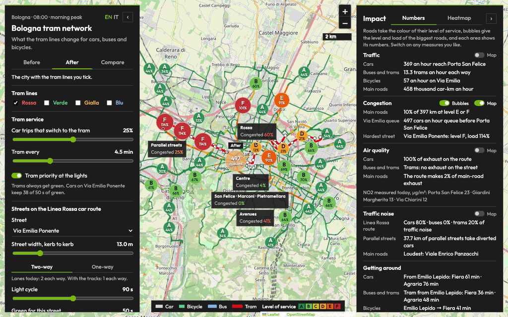
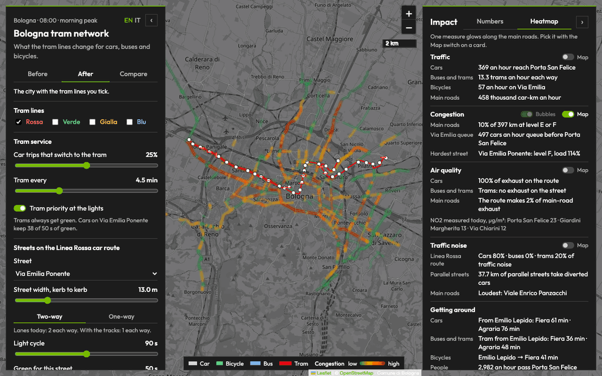
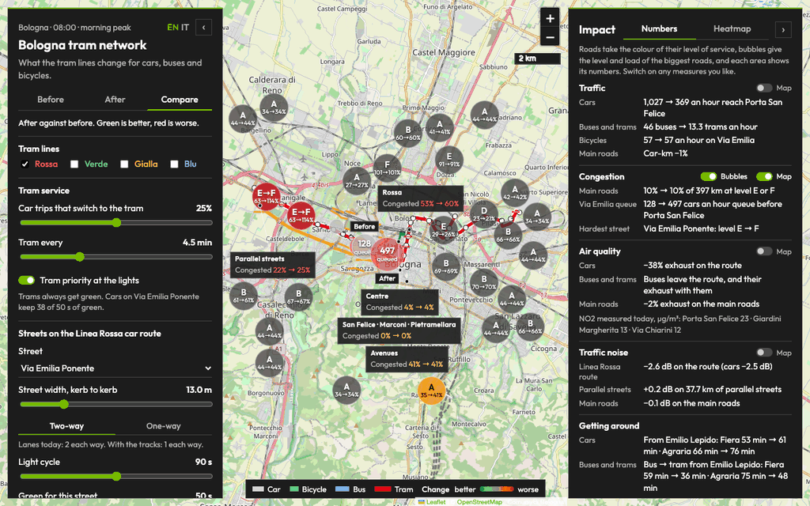
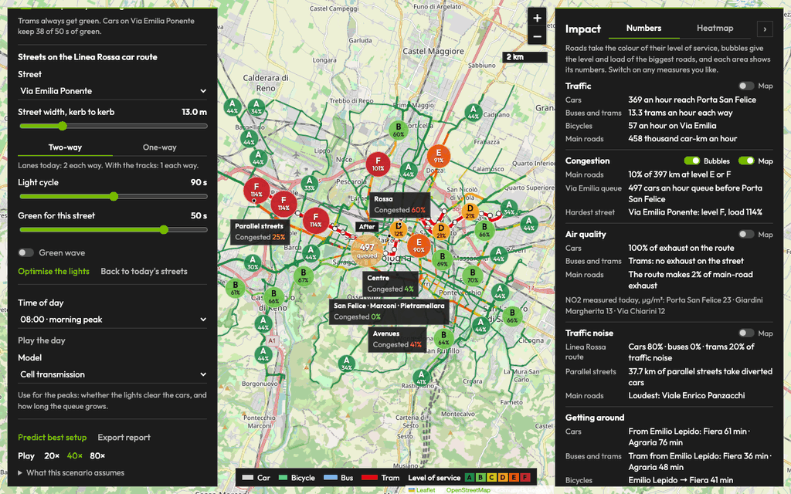
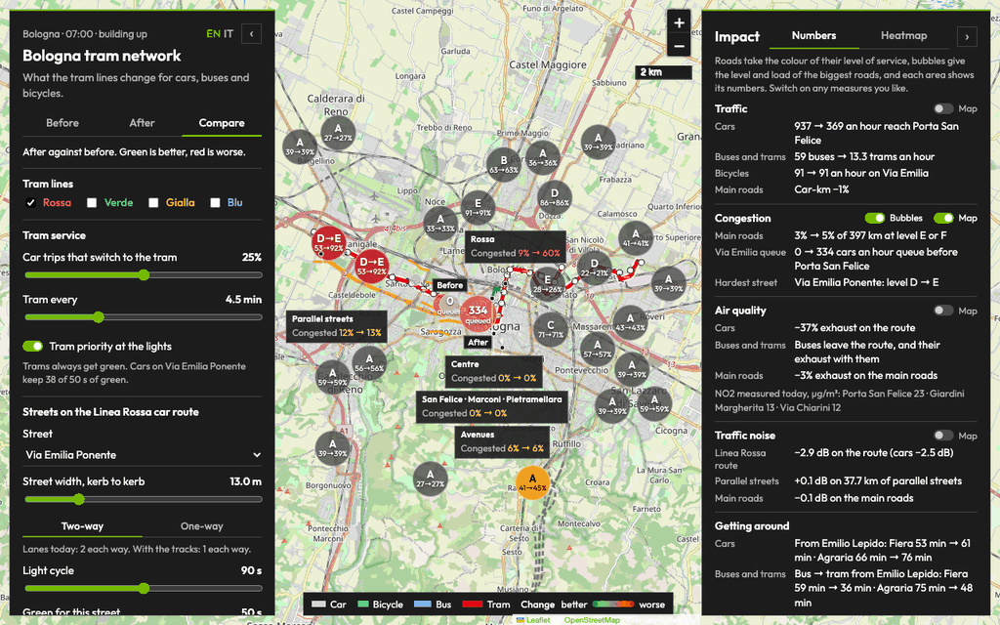
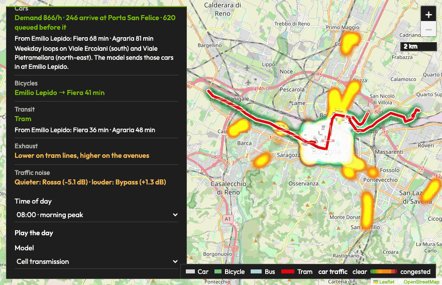
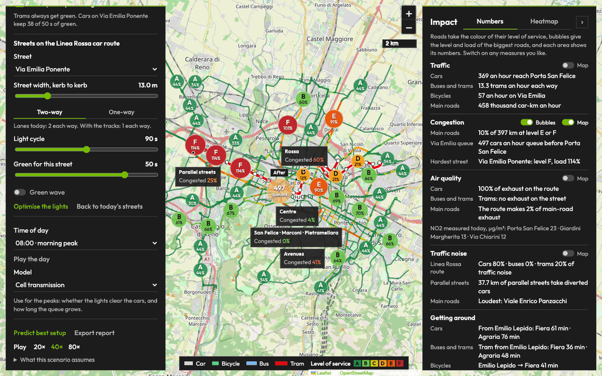

# User guide

This guide walks through every part of the Bologna tram traffic map: what each control does, how to read the map and the numbers, and how to use them to decide on tram priority, light plans, and one-way or two-way streets. The [README](../README.md) covers the models, the data, and the installation.

- [The screen](#the-screen)
- [Before, After, and Compare](#before-after-and-compare)
- [Numbers or Heatmap](#numbers-or-heatmap)
- [Reading the map](#reading-the-map)
- [The design panel](#the-design-panel)
- [The impact panel](#the-impact-panel)
- [Keyboard shortcuts](#keyboard-shortcuts)
- [The exported report](#the-exported-report)
- [Recipes for decisions](#recipes-for-decisions)
- [Limits](#limits)

## The screen

The map of Bologna fills the window. The **design panel** on the left holds everything you can change. The **impact panel** on the right holds the results. The legend runs along the bottom of the map.

The top line of the design panel shows the hour you are looking at, for example *Bologna · 08:00 · morning peak*, and the language buttons.

- **Language.** EN and IT switch the whole interface between English and Italian. The page remembers your choice. Add `?lang=it` or `?lang=en` to the address to open the page in one language. The exported report is in English.
- **Hide a panel.** The **‹** button at the top of the design panel and the **›** button at the top of the impact panel tuck the panel away. A tab at the top corner of the map, **Design ›** or **‹ Impact**, brings it back. The keys **[** and **]** do the same, and **\\** hides or shows both. The legend, the map controls, the labels, and the bubbles move into the space a panel leaves.
- **Phone.** On a narrow screen the design panel sits above the map and the impact panel below it. Both still hide and come back the same way.

## Before, After, and Compare

The three buttons under the title choose the scenario on the map and in every number.

- **Before** is the city today, with no tram.
- **After** is the city with the tram lines you tick.
- **Compare** puts After against Before. Green is better and red is worse, on the map and in the labels.

Changing something that only exists with the tram moves the map from Before to After, so you see the change straight away. That covers the tram lines, the share of drivers who switch, the tram interval, priority, the direction of a street, its lights, and the light optimiser. The keys **1**, **2**, and **3** pick Before, After, and Compare.

## Numbers or Heatmap

The **Numbers | Heatmap** switch at the top of the impact panel chooses how the map draws the results.

- **Numbers** colours every main road by its level of service and adds congestion bubbles on the biggest roads. Each area gets a label with its numbers. Turn on as many measures as you like with the **Map** switch on each card: traffic, congestion, air quality, and noise.
- **Heatmap** makes one measure glow along the main roads, on a dark basemap with thin tram lines. The **Map** switches then pick the measure, one at a time. Before and After use a scale set by that measure's spread across the city today, so the two scenarios are drawn alike. Compare shows the change.

## Reading the map

### Road colours

In Numbers, with the Congestion **Map** switch on, each main road takes a colour.

| View | Colour |
| --- | --- |
| Before, After | Level of service from the load, the cars against what the lanes and green can carry: A under 60%, B under 70%, C under 80%, D under 90%, E under 100%, F at 100% or more |
| Compare | Dark red: load up by more than 15 points. Orange: up. Light green: down. Dark green: down by more than 15 points. Grey: within 3 points of today |

The five streets of the Linea Rossa car route take their level from the selected model's delay at each light instead: up to 10 s is A, 20 s B, 35 s C, 55 s D, 80 s E, and F beyond that. With the Congestion **Map** switch off, the roads turn grey so the other measures stand out.

### Congestion bubbles

The bubbles give the level and load of the biggest roads at a glance. They sit on the named trunk, primary, and secondary streets, and a long street is cut into stretches of about 2 km, so each bubble describes the part of the street it sits on.

- **Before and After.** The letter is the level of service and the number is the load. Both are the typical value along the stretch, weighted by length. A fuller road draws a larger bubble.
- **Compare.** The bubble shows the change, for example *D→E* over *86→92%*. Its colour follows the load: dark red when it rises by more than 15 points, orange when it rises, light green when it falls, dark green when it falls by more than 15 points, and grey when it stays within 3 points.
- **Hover a bubble** for the street name, its level, load, and cars an hour, the busiest point on the stretch, and the length the value covers. On the five streets of the Linea Rossa route, the tooltip adds that the level comes from the selected model's delay at each light.
- **Placement.** Bubbles never cover each other, the area labels, or the queue at Porta San Felice. A bubble slides along its own street to find room. Up to 36 show at a time. When room runs short, the streets the tram runs along come first, then the streets it changes most, then the busiest. Zoom in to see more. On Via Marco Emilio Lepido, Via Emilia Ponente, and Via Aurelio Saffi, a street's bubble takes the place of the small queue markers.
- **Switch.** The **Bubbles** switch on the Congestion card turns them on and off. It works in Numbers with the Congestion **Map** switch on.

### The Via Emilia queue

With the Congestion **Map** switch on, a bubble at Porta San Felice gives the cars an hour that queue on Via Emilia before it, and smaller markers trace the queue back along the street. In Compare, the Before bubble is grey and the After bubble is green when the queue is shorter, yellow when it is about the same, and red when it is longer.

### Area labels

Each area gets a label with one row for each measure you switch on. The areas are the **Centre**, the **Avenues** (the ring of viali), **San Felice · Marconi · Pietramellara** (the car route around the historic centre), each open tram line, and in After and Compare the **Parallel streets** that take the cars diverted from the tram streets.

| Row | Before and After | Compare |
| --- | --- | --- |
| Cars | Cars an hour along an average kilometre of road | Change in car-km |
| Congested | Share of the area's roads at level E or F | Before → after |
| Exhaust | Low, moderate, high, or very high | Change in exhaust |
| Noise | Quiet, moderate, loud, or very loud | Change in decibels |

The row colour runs from green (low, or better) through yellow to red (very high, or worse). A label moved away from its area to make room keeps a thin line to it.

### Measured NO2

With the Air quality **Map** switch on, in Numbers, the three air stations show the mean NO2 measured in 2026, in µg/m³: Porta San Felice, Giardini Margherita, and Via Chiarini. The tram is not in service yet, so the measured values stay the same in every scenario. The modelled exhaust carries the change.

### Tram lines, stops, and vehicles

In After and Compare the open lines appear in their colours: Rossa red, Verde green, Gialla yellow, and Blu blue. Hover a Rossa stop for its name. Cars, bicycles, buses, and trams move along the Linea Rossa route at the speed the selected model gives them. **Pause** and **Play** stop and start them, and **20×**, **40×**, and **80×** set how fast the simulated clock runs.

### Road tooltips

Hover any main road for its name, lanes, cars an hour, load, and level. In Compare it gives before → after. With the tram, it also names the lines on that road and the extra cars an hour sent to it from the tram streets. The last line says where the cars come from: the Comune's loop detectors, an estimate from the same street or its road class, or the selected model for the five streets of the Linea Rossa route. Tooltips open on the side away from the panels.

### Legend

The legend explains what the map shows at that moment: the vehicle colours, the level of service key, the Compare scale from better to worse, the heatmap scale from low to high, and the measured NO2 marker.

## The design panel

### Tram lines

Tick **Rossa**, **Verde**, **Gialla**, and **Blu** in any combination. An open line takes a share of drivers, gives the tracks a lane each way on its streets, or shares the only lane, and sends the cars that no longer fit onto the parallel main roads. Rossa runs from Borgo Panigale through the historic centre to the Fiera and to Agraria at Pilastro. The four models run on the Linea Rossa car route, and every line changes the city's main roads.

### Tram service

- **Car trips that switch to the tram**, 0 to 50%. The share of Rossa's car trips that take the tram instead. Verde and Gialla take 8% and Blu 10% of the cars on their own streets.
- **Tram every**, 3 to 8 minutes. More trams carry more riders and, with priority, take more of the green.
- **Tram priority at the lights.** With priority, each tram passage, in both directions, takes 18 seconds of the street's green, up to 65% of it. The note under the switch gives the green the cars keep, for example *Cars on Via Emilia Ponente keep 38 of 50 s of green*. Without priority, the tram waits at red like the cars, and the note gives the wait at each junction and the extra minutes from Emilio Lepido to the Fiera.

### Streets on the Linea Rossa car route

Pick one of the five streets of the route in **Street**, or select its row in the Street check on the right. Every setting below applies to that street.

| Street | Part of the route |
| --- | --- |
| Via Emilia Ponente | From Emilio Lepido to Porta San Felice |
| San Felice · Marconi · Pietramellara | Around the historic centre, where Rossa runs through. No Rossa tracks |
| Via Matteotti · Via della Liberazione | Towards the Fiera, for 56% of the cars |
| Viale Aldo Moro | Into the Fiera |
| Via San Donato | To Agraria at Pilastro, for 44% of the cars |

- **Street width, kerb to kerb**, 10 to 24 m. The width sets the lanes. Before, a street of width W has W ÷ 6.5 lanes each way, rounded down. With the tram, the tracks take 6.5 m. Two-way leaves (W − 6.5) ÷ 6.5 lanes each way and one-way leaves (W − 6.5) ÷ 3.25 lanes, both rounded down. The streets start at 13 m, and San Felice · Marconi · Pietramellara at 20 m. Set the real width when you know it.
- **Two-way or One-way.** With the tram, one-way gives all the lanes left to the main direction. The cars of the other direction, 75% of the main flow, go round on parallel main roads. A street too narrow for two-way traffic beside the tracks becomes one-way on its own: One-way stays selected and the note under the switch says so.
- **Lanes note.** Lanes today and with the tracks, for the width and direction you set.
- **Light cycle**, 60 to 120 s, and **Green for this street**, 15 to 90 s. The street that crosses always keeps at least 30 s, so the green stops 30 s short of the cycle.
- **Green wave** lines up the lights along the street at 30 km/h.
- **Optimise the lights** finds the cycle, green, and green wave for each of the five streets that lose the fewest person-minutes with the selected model. It tries cycles of 60, 90, and 120 s, with 45%, 60%, or 75% of each as green, and the green wave on or off, one street at a time. The note lists the plan it chose and the person-minutes lost an hour before and after.
- **Back to today's streets** restores today's widths, directions, and lights on all five streets, and switches tram priority back on.

Before always keeps today's lights. A light plan you set, or the optimiser finds, applies to After, so Compare shows the plan and the tram together.

### Time of day

**Time of day** picks one of nine hours measured in the open data: 06:00 early morning, 07:00 building up, 08:00 morning peak, 09:00 late peak, 12:00 midday, 15:00 afternoon, 17:00 evening build-up, 18:00 evening peak, and 21:00 evening. Each hour has its own cars, buses, and bicycles. **Play the day** steps through all nine, and choosing an hour stops it.

### Model

**Model** chooses the corridor model for the Linea Rossa route: **Cell transmission** (the default), **Volume-delay**, **Car following**, or the **Neural surrogate**. The note under it says what each one is for. All four take the same inputs and give the same outputs, and all four run in the page. The README explains [how each one works and when to use it](../README.md#when-to-use-each-model).

### Predict best setup

**Predict best setup** searches for the tram setup that loses the fewest person-minutes an hour, with the selected model at the selected hour. It tries a tram every 3 to 8 minutes, with and without priority, with the streets as set or one-way where the tracks run, then optimises the winner's lights. The best setup goes onto the map in After, and the note sums it up, for example: *a tram every 5 min, no priority at the lights, streets as set, optimised lights; 3,628 people an hour pass Porta San Felice, 0 wait for a later tram, and the car trip from Emilio Lepido to the Fiera is 14 min shorter.*

The search weighs everyone in person-minutes an hour: the delay of every car that wants the trip and of the streets that cross the route, 30 minutes for each car or rider who cannot get through, 10 for each car sent round a one-way street, the riders' time on board, and 300 for each tram an hour it takes to run the service.

### Export report

**Export report** downloads an HTML report of the current design. It runs the setup search first, unless one already ran for the same model, hour, and share of drivers who switch. [The exported report](#the-exported-report) lists what it holds.

### What this scenario assumes

The section at the bottom of the design panel lists the assumptions behind the numbers: what the tram changes, how the main roads carry cars, how the surrogate was trained, and that the page models match the Python models in `sim/`.

## The impact panel

### The cards

Each card gives one row for each kind of traffic. Compare shows before → after on every row.

| Card | Row | What it says |
| --- | --- | --- |
| Traffic | Cars | Cars an hour that reach Porta San Felice |
| | Buses and trams | Buses an hour on Via Emilia today, trams an hour each way with the tram |
| | Bicycles | Bicycles an hour on Via Emilia |
| | Main roads | Thousand car-km an hour on the city's main roads, or their change in Compare |
| Congestion | Main roads | Share of the 397 km of main roads at level E or F |
| | Via Emilia queue | Cars an hour that queue before Porta San Felice, and the cars sent round a one-way street |
| | Hardest street | The street of the Linea Rossa route with the lowest level, and its load |
| Air quality | Cars | The cars' share of exhaust on the route, or its change |
| | Buses and trams | Trams have no exhaust on the street. With the tram, the buses and their exhaust leave the route |
| | Main roads | The route's share of main-road exhaust, or the change across the main roads |
| | NO2 measured today | The three stations, in µg/m³ |
| Traffic noise | Linea Rossa route | Cars, buses, and trams as shares of traffic noise, or the change in decibels |
| | Parallel streets | The kilometres of parallel streets that take diverted cars, and their change in noise |
| | Main roads | The loudest main road, or the change in decibels across the main roads |
| Getting around | Cars | Car trip from Emilio Lepido to the Fiera and from Emilio Lepido to Agraria |
| | Buses and trams | The same two trips by bus, or by tram with the tram |
| | Bicycles | Bicycle trip from Emilio Lepido to the Fiera |
| | People | People an hour past Porta San Felice, and riders who wait for a later tram |

### Map and Bubbles switches

The **Map** switch on the Traffic, Congestion, Air quality, and Traffic noise cards puts that measure on the map. In Numbers, any number of them can be on, and each adds a row to the area labels. In Heatmap, the switch picks the one measure that glows. The **Bubbles** switch on the Congestion card turns the congestion bubbles on and off.

### Street check

The table lists the five streets of the Linea Rossa route with their lanes, load, level of service, and queue. Load is cars and buses against what the street's lanes and green can carry. The level comes from the delay at each junction. Select a row, with a click or with Enter, to edit that street in the design panel.

### Busiest main roads, or main roads that change most

In Before and After, the list names the five busiest main roads, with their level and load at the busiest point. In Compare, it names the main roads whose load rises, with the change in level and in cars. The note under the list says how the car flows were measured.

### All numbers

The table at the bottom gives Before and After side by side: the car, bicycle, and transit trips from Emilio Lepido to the Fiera and from Emilio Lepido to Agraria, the car speed on Via Emilia, the cars an hour that want Via Emilia, reach Porta San Felice, and queue before it, the people an hour at Porta San Felice, the transit riders left waiting, and the person-minutes lost an hour.

## Keyboard shortcuts

| Key | Action |
| --- | --- |
| Space | Pause or play the vehicles |
| 1, 2, 3 | Before, After, Compare |
| [ | Hide or show the design panel |
| ] | Hide or show the impact panel |
| \\ | Hide both panels, or show both when both are hidden |

The shortcuts wait while you type in a field or pick from a list.

## The exported report

The report is a single HTML file in English, named for the hour and the model, for example `bologna-tram-08-ctm.html`. It holds:

- The model, the hour, the tram interval, priority, the share of drivers who switch, and the open lines.
- The cars, buses, and bicycles of that hour in the open data.
- The five streets of the Linea Rossa route as you set them: width, lanes before and after, the lights in After, load, level, and queue.
- The impact before and after, row by row.
- The main roads that change most.
- The best setup the search found, its streets, and the ten best setups it compared, with their cost.
- What the numbers rest on: the data sources and the assumptions.

## Recipes for decisions

### Should trams have priority at the lights?

1. Choose the hour, then **Compare**.
2. Switch **Tram priority at the lights** on and off. Watch the note under it, the Cars row on the Traffic card, the Via Emilia queue, and the car and tram trips from Emilio Lepido to the Fiera on Getting around.
3. Open **All numbers** and compare the person-minutes lost an hour.
4. Run **Predict best setup** to weigh priority together with the tram interval, one-way streets, and the lights.

### Is a street wide enough, and should it run one-way?

1. Pick the street and set its real **width**.
2. Read the lanes note. A street too narrow for two-way traffic beside the tracks turns one-way on its own.
3. Switch **Two-way** and **One-way** in **Compare**. One-way gives the main direction more lanes and sends the other direction round on parallel roads: watch the Via Emilia queue row, the Parallel streets label, and the bubbles on the roads around the street.

### Which light plan?

1. Pick a street and move **Light cycle**, **Green for this street**, and **Green wave**. The Street check and the bubbles show the effect.
2. Press **Optimise the lights** for the plan with the fewest person-minutes lost on all five streets. Its note lists the plan.
3. Change the hour or the model and optimise again to see whether the plan holds. **Back to today's streets** starts over.

### Where do the diverted cars go?

1. Choose **Compare** with the Congestion **Map** switch and **Bubbles** on.
2. Red and orange roads and bubbles are the roads that take cars. The list of main roads that change most names them, and the Parallel streets label sums them up.
3. Switch to **Heatmap** and pick Traffic for the same change as a glow along the roads.

### What does the full network change?

Tick **Verde**, **Gialla**, and **Blu** beside Rossa, in Compare. The Congestion card gives the share of the city's main roads at level E or F, and the bubbles show which streets change.

### How does the day change the answer?

Press **Play the day** in Compare and watch the bubbles and the cards from 06:00 to 21:00. The morning peak at 08:00 and the evening at 17:00 and 18:00 bring the most cars onto the route: 1,155, 1,199, and 1,233 an hour.

### Do the models agree?

Switch the **Model** with the same design and compare the cards. Run **Predict best setup** with each model. The README table [compares the four models](../README.md#the-linea-rossa-route) on the same morning.

### Share a design

Press **Export report** and send the HTML file. It opens in any browser.

## Limits

The numbers come from the models in this repository and the data the Comune di Bologna, TPER, and OpenStreetMap publish. They are a scenario, not a forecast or an official figure. A few inputs are assumptions: today's light timings, the street widths, the corridor demand, and car occupancy. Exhaust is a traffic proxy and noise is an estimate from traffic volume. The README [disclaimer](../README.md#disclaimer) lists them all.
